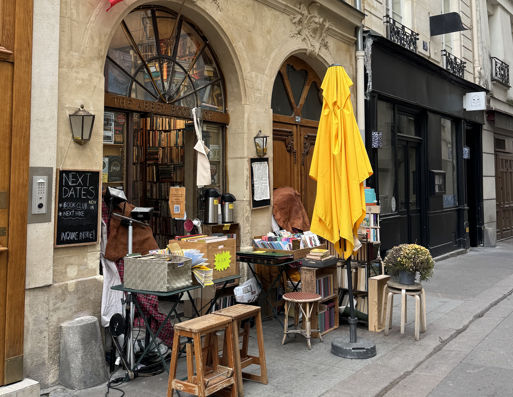

I love love love books. You'll almost always find me with both a book and a journal in my bag. There's something so cool about being transported to another world or getting to deep dive into a subject. I really believe there's a book for everyone.

While I do read in French, I do still enjoy reading in English more. If I want to read a French book, I usually go a public library and borrow a book. Libraries are truly wonderful places - there are some in Paris that even have puzzles on a table ready for anyone to participate in.

Here are some of my favourite independent English book stores in Paris.

## The Abbey

This place is magical, if I could bottle the joy I get every time I go here, I would. I could spend hours just looking at books here, bookshelves behind bookshelves, floor to ceiling of books. I love taking friends that are visiting here and everyone loves it.

They have a large variety of books including a selection that is second hand. All of the staff (who appear on the "wall of fame" with their photo and name) are super helpful when it comes to finding books.

I prefer coming here when I don't have a book in mind because I just love taking the time to browse. Be aware that the space here is pretty tight, so it can be hard to pass people when you're looking at books especially if you have a backpack on. You can also order a book online, every time I've done that they've got back to me super fast to either tell me that it's in stock and they've placed it behind the till for me, or they need to order it in and will give an approximate date of delivery.

I spent a lot of time in this neighbourhood, with it being so close to the Notre Dame, so it's always easy for me to pop in and pick up an ordered book.

I like that they have a loyalty program - when you get to 100€ you get a free tote bag. They keep track of what you've spent on bookmarks which I think is cute. It's nice being able to see the books that I've bought from there.

They usually have tea & coffee at the entrance which is a nice treat after book shopping.

## Shakespeare and Company

This is probably the most known English book store in Paris. There is often a queue to get into the shop - sometimes people start queueing before the store opens. They do this to ensure that people in the store have enough space to look at the books. Inside they have a strict no photo policy which I personally love.

They also host events which are usually free. They share the details on their website, instagram and facebook page of upcoming events. I've been to two events (Shelia Heti and Michael Donkor), the first was on the ground floor and the second was held upstairs. In summer, if the weather permits they also host events outside. At the end of the event, you're able to buy a copy of the book & get it signed by the author. If you're planning on attending, I'd suggest arriving 30 minutes before so you can be sure to get a seat - otherwise they have space where you can stand (you can't always see the stage which personally isn't a big deal for me). If you want to attend the event but are unable to make it there they record the talk and upload it to their podcast.

They have a website where you can order books either for delivery or for a store pickup - if I'm after a specific book then I usually order it online and pick it up in store. If you have ordered a book online, you do not need to queue, you can show your email to the person on the door and they will let you in.

Both when you order a book online or buy one from store, you get the option to have the book stamped (I always opt to have mine stamped).

They have a cafe just next door where the collaborate with other local producers.

## The Red Wheelbarrow Bookstore

The Red Wheelbarrow and The Red Balloon are two independently owned book stores, just next to each other. The different book stores focus on different categories. The Red Balloon focuses on children's books, both in English and in French.

The stores are smaller that The Abbey and Shakespeare and Co, but I thought they still had a good collection of books. The staff are friendly and can offer advice on books, and which of the book stores will have a specific book if you're looking for one.

It's just opposite Jardin du Luxembourg, so the perfect place to sit and read a new book!

## Smith & Son

They have two locations, one on Rue Rivoli just opposite the Jardin des Tuileries and a second one in the Marais. The main store on Rue Rivoli has a tea room and a selection of British foods (think Irn Bru and Terry's chocolate orange both of which hold a special place in my heart) that you can't find easily in France.

They have a website where you can order books and you can see what books they have in stock. This store is usually less crowded compared to The Abbey and Shakespeare and Company - they have more space to move around.

## San-Francisco Book Co

This time, the store focus is on second hand books.

One of the things I love about second hand book stores is you never know what you're going to find. You have to spend the time looking through the books until you find one that catches your eye.

They have a website where you can order books - although I have never tried.

## Book Off

There are a few different Book Off stores in Paris which is a store that focuses on second hand books (mostly in French), CDs and DVDs. They all have a selection of second hand English books (along with other languages!).

I was an au pair for my first two years in Paris, so I spent a lot of time in Book Off because the books were the cheapest here. I found many good English books for 1€, the most I ever spent on a book here was 3,5€. I still visit the store, but now I usually buy my books from The Abbey or Shakespeare and Co. This is also a great place to buy books if you're wanting to learn French because of the large variety of choice at a good price.

## Your suggestions?

If you know of any other English book stores, then I'd love to hear about them! You can reach me via instagram at **[@abi.in.france](https://www.instagram.com/abi.in.france/)**
