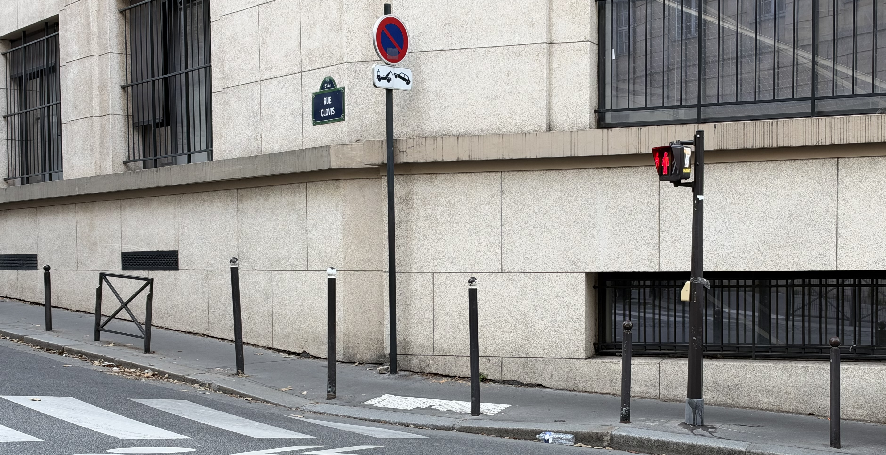
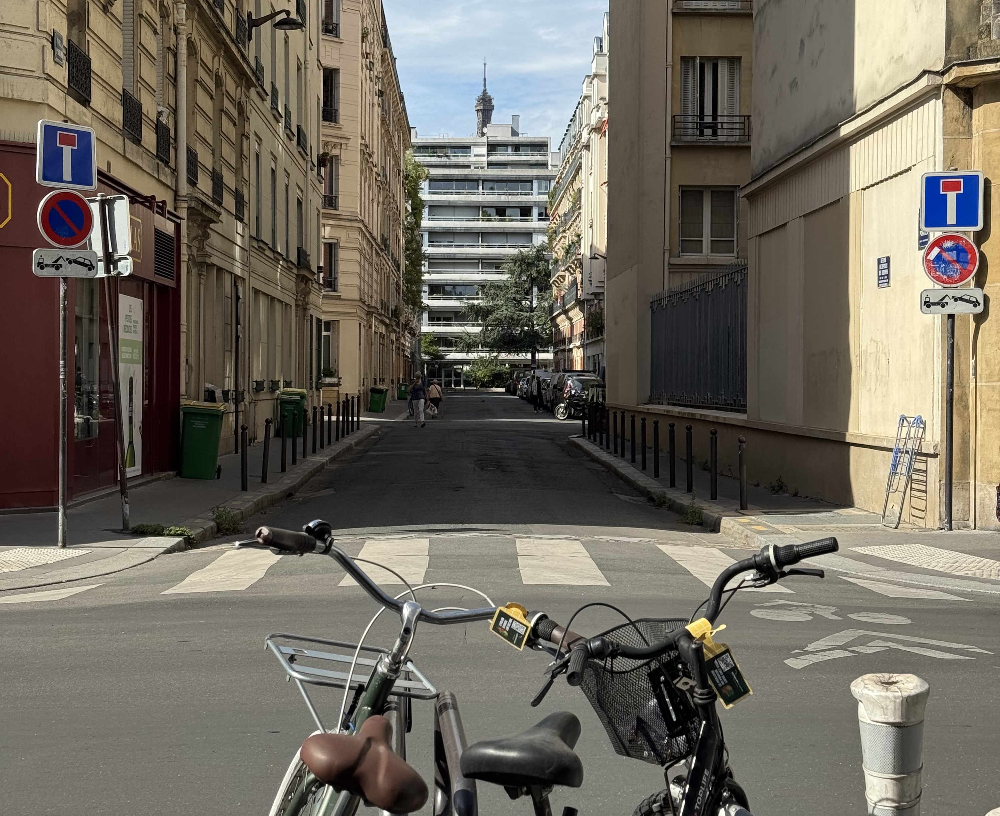

On tours, I often get asked questions about how to cross the roads in Paris. Usually this question comes after we have crossed at a zebra crossing or _marked crosswalk_ with cars having to stop for us. I will be continuing to call it a zebra crossing for the remainder of this article, not only because I am british, but just because it sounds cooler.

You might think this is a simple question, but every country does something slightly different. For example, in the UK, as a pedestrian, you'll never have a green light at the same time as drivers. In France, that can be the case where drivers have to give way to pedestrians. I was surprised in Barcelona, that as soon as the light for pedestrians turned red, the cars have green, with no buffer window. In Paris there is a buffer window, and you'll often catch Parisians dashing across at the last second.

There are a few different styles of crossings, and that changes who has priority. If you hear sirens, always pause to identify where they are coming from _before_ crossing the road. You'll be surprised at how many people do not stop when they hear sirens.

This is a guide. Always pay attention to your surroundings, and keep yourself safe. While there is the road rules (code de la route), it does not mean that every driver is going to respect it.

### pedestrian lights

This is the simplest case. If there are pedestrian lights, you do need to follow these rules. A green light means you can cross, a red light means you should stop.

You'll probably notice that a lot of Parisians do cross when it's red. I _can't_ recommend doing this, but _if_ you are going to, make sure you look both directions. There's a lot of bike lanes that run the counter direction of one way streets. In theory, you can get a fine for crossing when it's red, but realistically the police have better things to be doing.

### no pedestrian lights

If you come across a zebra crossing with no pedestrian lights, you have priority. There are a few things to be aware of. First, if a driver thinks you are either not going to cross, or not ready to cross the road, they will not stop. You have to be confident, show that you are about to cross and they will stop. It can definitely feel uncomfortable, and I totally understand that especially if you're not from a big city. In most cases, you'll be able to see cars beginning to slow down which indicates they're going to stop. Don't forget to look both directions.

This is harder on certain long roads, because the flow of cars is restricted by traffic lights. If you can see that there are traffic lights on the road to your right, then you can be sure that _soon_ the cars will have to stop anyway. In that case, I often wait (while standing _away_ from the road). Drivers are less willing to stop if they have just stopped or are hoping to get through the next green light before it changes to red.

You'll sometimes come roads with multiple lanes of traffic. If a large vehicle has stopped such as a bus, always double check there's nothing in the next lane before continuing.

### two way crossing

On some crossings, you'll have a small little island in the middle. Sometimes there's text that says "piétons attention feux décalés". This means that pedestrians (piétons) need to pay attention because the lights are desynchronised. This mean, you can have a green light to cross to the island, but the other side may be red.

### Accessibility

On the crossings with lights, you'll see these little boxes, about hand height (see the photo above under pedestrian light). These little boxes are an accessibility tool. I often use these on tours, so that I can look at my group, with my back to the lights but still know when we'll be able to cross. I will also use this in summer when the sky is very bright - sometimes the green can be hard to see.

The trick with these, is there's a button underneath. Tapping the side does nothing. The button underneath activates the sound but it does _not_ change the speed at which the lights change. After the sound has been activated, you will hear, in French, a warning that the light is red followed by the name of the street. When it turns green, it makes a nice little jingle!

### traffic lights are out of service

There's a few things you should do if you're at a crossing with pedestrian lights that appear to be off or broken. First, check the pedestrian lights on your side of the road. Sometimes, especially when it's sunny, the green lights can be hard to see. Next, if the lights are still not on, you should look to see if the cars have any issues with their lights.

If they have a flashing orange light, it means that normal priority rules apply. Normal priority means drivers give way to the right, and pedestrians have priority. HOWEVER, you do need to be extra careful when crossing, because drivers like to think they can just keep going (they _should_ stop). Make eye contact, be confident, but be prepared for them to not stop. Your safely comes first.

### Bikes (pay attention)

While drivers in Paris are usually good at stopping for pedestrians, cyclists are known to be a bit of a problem. They're always dashing around the city, weaving their way through pedestrians that are crossing a road. The city of Paris is getting stricter, and enforcing more of these rules by giving fines, but for now, you need to be aware of them.

There's this unspoken rule in Paris, that a cyclist is not going to stop, so the cyclists behind do not anticipate that they will need to stop. When you're behind, you get a lot less visibility. I love cycling, but I do not do it in Paris because I find the whole experience to be a bit overwhelming.

### Got in contact

Got any questions about cross the road? Have I missed any crossing? Get in contact via instagram at **[@abi.in.france](https://www.instagram.com/abi.in.france/)**!
