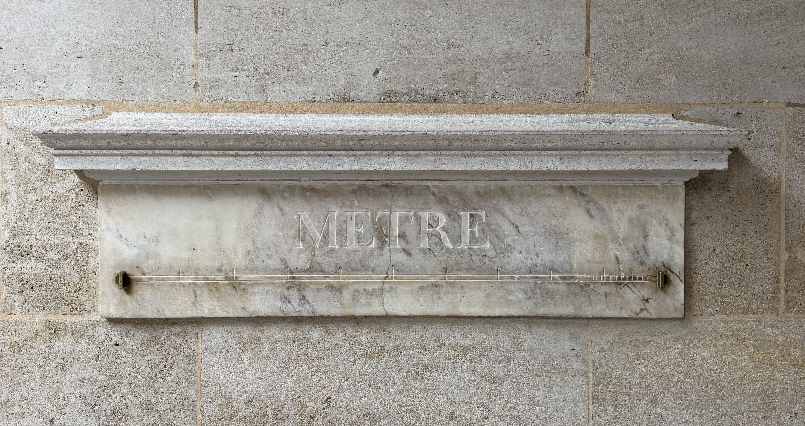

Recently, a guest reached out to me asking for a tour of the latin quarter. In their initial message, they said they had mobility issues and walked with a cane. By time the tour came around a few months later, they were using a wheelchair. If you've been to Paris before, you'll know it's definitely not the most accessible city in the world. It's really important to me that my tours are designed around you!

Accessibility is something I think about a lot. Thankfully Paris is getting more accessible, but these things take time. I have done kid friendly tours before with pushchairs, which is definitely not the same as a wheelchair accessible tour, but it does show that accessible infrastructure benefits a lot of people.

My first wheelchair accessible tour was a success! So well, they booked for a second tour in the same week. Booking a second tour in the same week is the _biggest_ complement to a tour guide!

<a class="cta" href="/book/">Book a tour</a>

This tour took us 2h30 starting at the Notre Dame and ending at the Arènes de Lutèce using a compact electric wheelchair. We stopped along the way to talk about landmarks, their history and why they're important. At the bottom of this article, you'll see a map with the main points pinned. If you notice any issues, please don't hesitate to reach out!

[Jump to map](#map)

**This is a guide**, and the actual conditions of the streets may vary. Weather, construction work and type of wheelchair all play a role in how accessible this is.

### The route

I met them in front of the _Notre Dame_. They had already been inside the Notre Dame before our tour started. If you use a wheelchair, a cane or have a disability, you can skip the line - the staff there (and in most monuments in Paris) are welcoming and happy to help. After talking about the Notre Dame, we left Île de la Cité, heading into the latin quarter.

I pointed out _Shakespeare and Company_. Directly in front of the store you have a choice of a narrow pavement or cobblestones which we were avoiding when possible (there are a few short sections of cobblestones on this route) so we took the path at road level. The people on my tour were big book fans, so we also passed by _The Abbey_ which is my favourite english speaking book store in Paris. On our way there, I pointed out the narrowest street in Paris, _Rue du Chat Qui Pêche_. While The Abbey is not wheelchair accessible (it's incredibly narrow inside), the staff are all lovely and I'm sure they would be happy to find a book and bring it out to you. The guest on my tour who did not use a wheelchair went inside.

The next stop was _Luxembourg gardens_. We walked along _Boulevard Saint-Michel_, passing by _Cluny museum_ - we did not go inside but it is an accessible museum (details on their [website](https://www.musee-moyenage.fr/en/are-you/with-specific-needs/with-a-physical-disability)). Luxembourg gardens, also known as the _Sénat gardens_, is one of my favourite gardens in Paris - in the summer, it's a popular spot for a break so finding a place to sit can be hard.

We entered via the entrance opposite _Rue Gay-Lussac_ (see on map below). Inside the garden, the terrain is mostly gravel but they do also have some paths - these paths are sometimes sloped. After entering, you can follow these paths around towards the left until you see the sloped entrance down onto the lower level (see on map below). Here, you get a great view of the Sénat, the flowers and the fountain where kids play with sail boats (they're a lot of fun).

We walked around the fountain, on the right side of the Sénat passed the _Medici fountain_ and exited via the exit opposite _rue Rotrou_. There's a dropped curb right by the exit, so it is a bit of a tight corner.

To the north of Luxembourg gardens on _Rue de Vaugirard_, you'll can find one of the original meter sticks first installed during the French Revolution. Getting here, there are a few tight corners on slanted pavements, notably the corner of _Rue Garanciere_. Don't be alarmed when you see the stairs, directly in front of the meter stick, they have a ramp to enter under the arcade.

Going back the same way, we headed towards the _Pantheon_. We spoke about some of the famous people buried there and why it's an important monument. A banner of Marc Bloch was hanging up in front since he was the last person to enter the Pantheon. We were there at the end of October so also spoke about education system - the Sorbonne university just in front of the Pantheon was blocked by students for the fourth week in a row.

Behind the Pantheon, on _Rue Clovis_, you'll find part of the historic wall of Paris created by Philippe II Augustus in the 12th century. If you look up, there's a small plaque on the wall that tells you what it is (this plaque is easy to miss!). The pavement on this street is fairly narrow and does go downwards. Most of this wall no longer exists, but there are a few locations where you can still see it in Paris. I remember the first time I saw this wall, I was surprised at just how big the wall is both in terms of height and width. Follow this road down, and turn left at the crossing on Rue du Cardinal Lemoine. If you are on the left side of the road, turning left is a sharp corner! Follow the road down, and turn right on _Rue Monge_.

On Rue Monge, turn left on _Rue de Naverrre_ to get to the accessible entrance of this park. And that brings us to the _Arènes de Lutèce_, the final stop on this latin quarter tour. There's a slope to get down into the main arena. I personally love this place - both in terms of what it represents historically but also how it is used by people today.

We left through the entrance we came in, ending out tour back on the main street. From there, they took a taxi back to their hotel.

### Challenges

While this route is wheelchair accessible and is all doable, there are a few parts to pay extra attention too.

- there are some cobble stones, but only for short periods (like crossing the road by Shakespeare and Company)
- sloped paths in Luxembourg gardens
- some of the dropped curbs are a little higher than they should be
- a sharp corner between the arcades along Rue de Vaugirard
- the corner between Rue Clovis and Rue du Cardinal Lemoine is a narrow and sharp corner on a downward section

### Get in touch

If you have any questions about this route, or would like to book a tour, feel free to **[get in touch](mailto:contact@abisummers.com)**!

