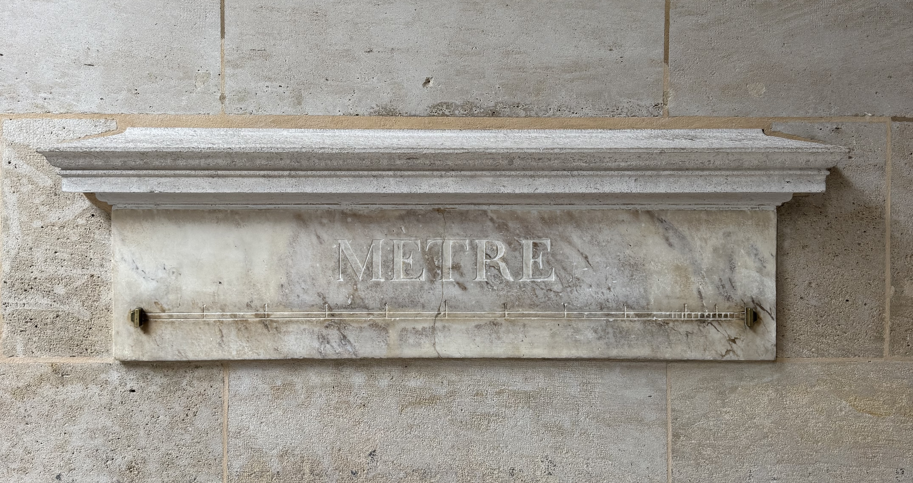
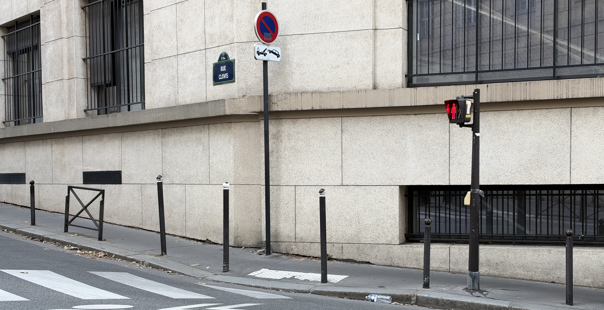

Recently, a guest reached out to me asking for a tour of the latin quarter. In their initial message, they said they had mobility issues and walked with a cane. By time the tour came around a few months later, they were using a wheelchair. If you've been to Paris before, you'll know it's definitely not the most accessible city in the world. It's really important to me that my tours are designed around you!

Accessibility is something I think about a lot. Thankfully Paris is getting more accessible, but these things take time especially because a lot of buildings are old and don't have much space to play with. I have done kid friendly tours before with pushchairs, which is definitely not the same as a wheelchair accessible tour, but it does show that accessible infrastructure benefits a lot of people.

My first wheelchair accessible tour was a success! So well, they booked for a second tour in the same week. Booking a second tour in the same week is the _biggest_ complement to a tour guide!

<a class="cta" href="/book/">Book a tour</a>

This tour took us 2h30 starting at the Notre Dame and ending at the Arènes de Lutèce using a compact electric wheelchair. We stopped along the way to talk about landmarks, their history and why they're important. At the bottom of this article, you'll see a map with the main points pinned. If you notice any issues, please don't hesitate to reach out!

[Jump to map](#map)

**This is a guide**, and the actual conditions of the streets may vary. Weather, construction work and type of wheelchair all play a role in how accessible this is.

### The route

This tour starts at the _Notre Dame_. If you use a wheelchair, a cane or have a disability, you can skip the line - the staff there (and in most monuments in Paris) are welcoming and happy to help. You can spend _hours_ looking at the details of the Notre Dame! After you have enjoyed the spectacular cathedral, you can take the bridge _Pont au Double_ south into the latin quarter. Cross the road at the traffic lights, then turn right and cross the road again.

On your left you'll see _Square René Viviani_, a public park where you can find the oldest tree in Paris. Just past the park, you'll see _Shakespeare and Company_. Directly in front of the store you have a choice of a narrow pavement or cobblestones (there are a few short sections of cobblestones on this route), but I'd recommend staying at the road level. Crossing _Rue du Petit Pont_ you'll get into the neighbourhood with the narrowest street of Paris - _Rue du Chat Qui Pêche_. (I don't recommend this area as places to get good food.) You can really imagine what Paris would have looked like before the big redesign by Haussmann the started in the 1850s. Incredibly different to the Paris of the 21st century.

The next stop was _Luxembourg gardens_. Following _Boulevard Saint-Michel_ south, passing the _Cluny museum_ (an accessible museum details on their [website](https://www.musee-moyenage.fr/en/are-you/with-specific-needs/with-a-physical-disability)). Luxembourg gardens, also known as the _Sénat gardens_, is one of my favourite gardens in Paris. In the summer, it's a popular spot for a break so finding a place to sit can be hard. In Autumn, the tones or orange and yellow really add to the atmosphere, especially when the sky is blue.

The entrance opposite _Rue Gay-Lussac_ (see on map below) is accessible. Inside the garden, the terrain is mostly gravel but they do also have some paths - these paths are sometimes sloped. Thankfully this garden is very well maintained so you rarely have to worry about fallen leaves that make the ground slippy. After entering, you can follow these paths around towards the left until you see the sloped entrance down onto the lower level (see on map below). Here, you get a great view of the Sénat, the flowers and the fountain where kids play with sail boats (they're a lot of fun).

Passing the fountains, turning right and following the path, you'll see the the _Medici fountain_. There's a dropped curb right by the exit, opposite _rue Rotrou_, so it is a bit of a tight corner.

The next point of interest is one of the original meter sticks first installed during the French Revolution. This it to the north of Luxembourg gardens on _Rue de Vaugirard_. To get here, there are a few tight corners on slanted pavements, notably the corner of _Rue Garanciere_. Don't be alarmed when you see the stairs after crossing the road, directly in front of the meter stick, they have a ramp to enter under the arcade.

Going back the same way and the following the outside of Luxembourg gardens, head towards the _Pantheon_. The pantheon is _not_ entirely wheelchair accessible, but it can still be admired from the outside! On their website they state "Le Panthéon n’est que partiellement accessible en autonomie aux visiteurs en fauteuil", which translates to "The Panthéon is only partially accessible to visitors in wheelchairs who are unaccompanied". More information can be found on their [website](https://www.paris-pantheon.fr/en/visit/visitors-with-disabilities/offre-adaptee-aux-visiteurs-en-mobilite-reduite) (in French).

Behind the Pantheon, on _Rue Clovis_, you'll find part of the _historic wall of Paris_ created by Philippe II Augustus in the 12th century. If you look up, there's a small plaque on the wall that tells you what it is (this plaque is easy to miss!). The pavement on this street is fairly narrow and does go downwards. Most of this wall no longer exists, but there are a few locations where you can still see it in Paris. I remember the first time I saw this wall, I was surprised at just how big the wall is both in terms of height and width. Follow this road down, and turn left at the crossing on _Rue du Cardinal Lemoine_. If you are on the left side of the road, turning left is a sharp corner (pictured below)! Follow the road down, and turn right on _Rue Monge_.

On Rue Monge, turn left on _Rue de Naverrre_ to get to the accessible entrance of this park. And that brings us to the _Arènes de Lutèce_, the final stop on this latin quarter tour. There's a slope to get down into the main arena. I personally love this place - both in terms of what it represents historically but also how it is used by people today.

### Challenges

While this route is wheelchair accessible and is all doable, there are a few parts to pay extra attention too.

- there are some cobble stones, but only for short periods (like crossing the road by Shakespeare and Company)
- some of the dropped curbs are a little higher than they should be
- a sharp corner between the arcades along Rue de Vaugirard
- the corner between Rue Clovis and Rue du Cardinal Lemoine is a narrow and sharp corner on a downward section (pictured above)

### Get in touch

If you have any questions about this route, or would like to book a tour, feel free to **[get in touch](mailto:contact@abisummers.com)**!

