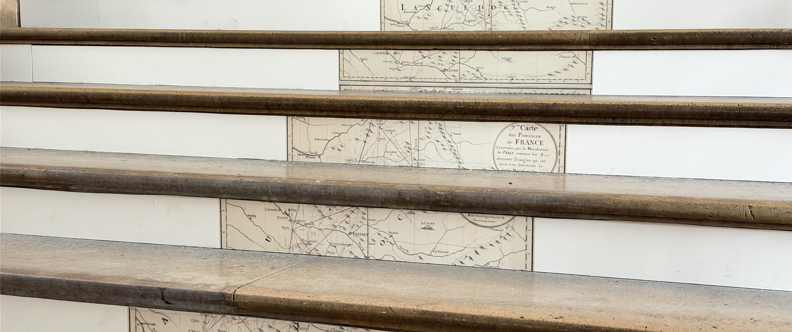
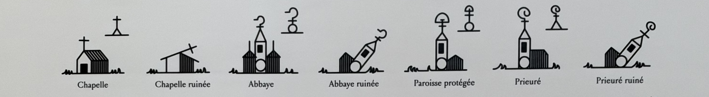
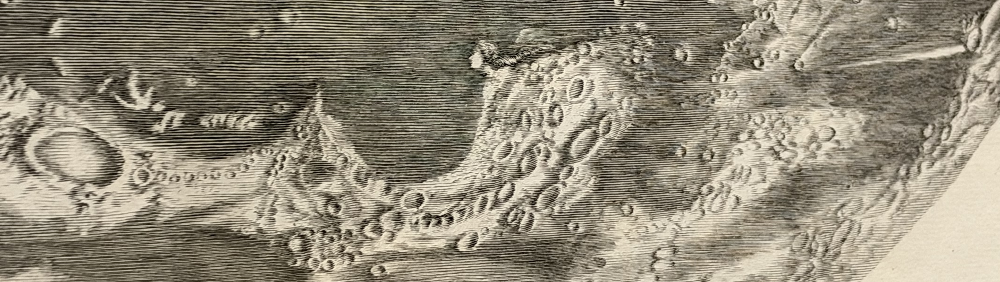
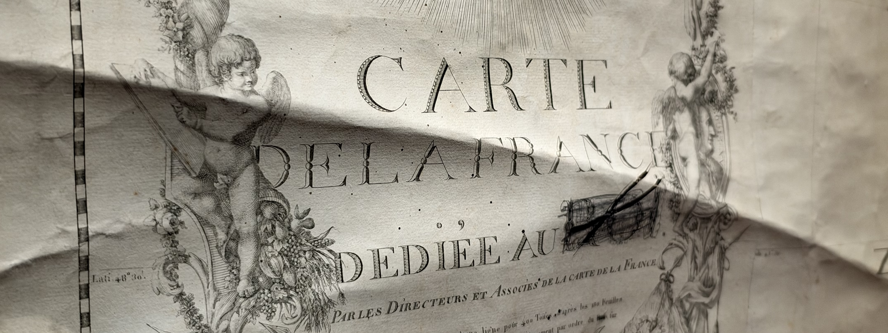

I always love exhibitions at the National Archives. I like that they decorate the stairs, so even before you're in the exhibition you get a taste of what's coming. Bonus, exhibitions here are free!

I love maps, so I knew that I wanted to visit as soon as I saw the posters hanging up outside the National Archives. My partner is also a big fan of maps, so we found the time to go together. In our dining room, we have two maps hanging up. The larger map, a gift for my birthday from my partner, is of Paris from the 16th century - this map is a real conversation starter when we have people over because Paris has changed a lot since then. The more you look, the more you notice. The smaller one is from Michelin showing all the roads of France in 1970.

I use maps almost every day from checking direction, to checking opening hours of cafes. On [tours](/book/), I'll often show the metro map that's outside a station because it really is one of the best ways of getting across the city. I even have a google maps link with all of my favourite places around the city that I give out on tours. Maps are everywhere!

All of the main explanations have been translated into English, but there are some things that are only in French.

### Maps

Depending on where you live, or where you grew up, you might associate maps with different people. In France, Cassini is the big name. The Cassini Map of France was the first map of the country to be surveyed geometrically on a national scale.

This exhibition is all about the creation of these maps of France, why they were created, who funded them and their important role. Even today, they are considered an important document. Cassini does not just refer to one person, but in fact a family of men who worked on mapping France, a trade passed down from father to son. In total four generations of Cassini's worked on creating these maps, starting in the 17th century.

I don't often think about how maps were made (or even how they are made today with modern technology). There's some complicated maths that goes into to the calculations. What I hadn't really considered, was how they were reproduced. The Cassini maps, were _engraved_. Meaning, that they'd go out, collect all of the data that they needed, presumably make a copy the correct way and then flip it to engrave it. When you look at the engraving, it is clear that everything is reversed. In section two, you can see both an engraving and a print of the same map.

While there's a lot of very cool maps, the one that makes go you 'wow' is walking into the third section and seeing the Cassini Map of France. It's made up of 181 sheets, measuring eleven meters in width by twelve meters in height. It's so big, that it has been split over two walls. I've not included any photos here because I don't want to ruin the surprise! While not all 181 sheets are there, the are all printed and cover two walls. A handful of the actual copies from the archives are framed.

As you walk in, on the right hand wall, you'll find a legend to go along with the maps. So many icons! I really wonder how often they used the wrong symbol, because some of them are very similar. Surely _some_ are wrong. In this section, you'll also see some of Marie Antoinette's maps in the form of a book.

### Get out what you put in

You can just look at the maps and say 'cool', but I think you get a lot more out of it when you take the time. Maps change a lot over time, cities expand, roads are built. You have to _really_ look at the maps, and reflect on what you're seeing. There's a lot of details, sometimes more hidden than others. In some maps, you can see where two different papers were joined. I really liked the map of the moon, which includes a face of the map makers wife.

I personally, like trying to find places that I have been to. I've been to a lot of places across the country, some of them smaller than others. It turns out, my sense of orientation in France isn't as good as I thought it was. Placing cities is hard!

It's also important to think about how maps were used, and how they still are used as a political tool. On the corner of one of the maps, you'll see that the word _roi_ (king) has been crossed out, along with the _fleur de lys_, a symbol of royalty.

in the fourth section, there's a map that I spent a lot of time trying to place Paris on. Turns out, Paris was much further west that I expected because the borders of France had changed. On the legend of this map, you may also notice that the map was created in year XII. This was because they were still using the calendar created during the French Revolution. Later changes to the maps, changed back to the old system (our current system).

### The next room

Once you've finished at the main exhibition, I'd recommend heading into the next room (between section two and three). In here, you're going to find some really important documents that have shaped France! They also have art related to the map exhibition which I think is really cool.

### Closing thoughts

I had a great time! We spent around 1h30 in the exhibition, which involved discussing the maps (like where we'd been on holiday or how Paris has changed).

With an exhibition like this, I think you get more from the exhibition when you slow down and look for the details. Try and find places that mean something to you, where you live, where you go on holiday, or even where you'd like to visit next. This is not always easy because the exhibition can get busy, especially on a weekend or public holiday - maps interest a lot of people _and_ it's free to enter.

I will say, the layout of this exhibition is not fantastic. You end up needing to going backwards in the first two sections if you want to see everything. They also have some documents underneath the maps, meaning you can't get that close to the maps on the wall, and you have more people surrounding both documents.

If after visiting the main exhibition, you want to visit the other room you need to pass through the exhibition to get there. You can't just follow one wall, you need to turn back to see the rest.

I think it's also important to note that maps are _still_ political. There are many disputed borders throughout the world, and maps continue to change over time.

### Share your thoughts

Have you been to this exhibition? If so, I would love to exchange thoughts! You can reach me via instagram at **[@abi.in.france](https://www.instagram.com/abi.in.france/)**
